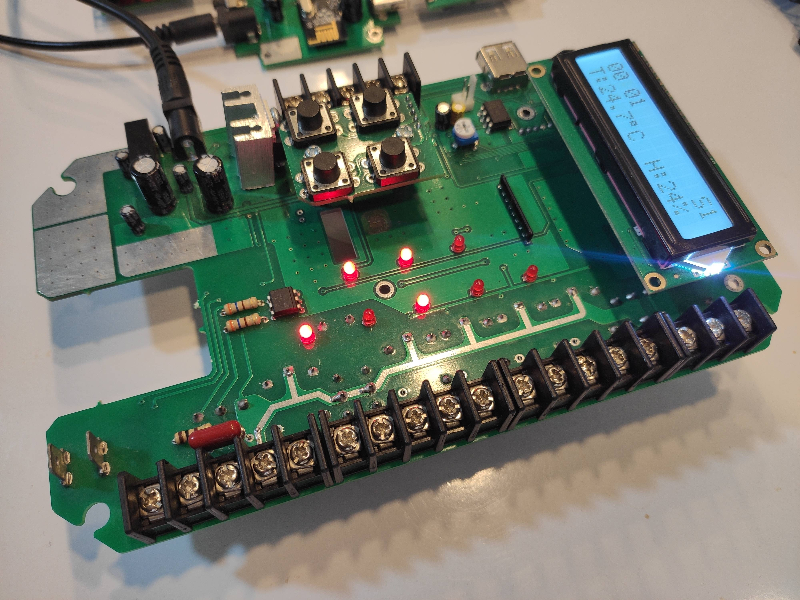
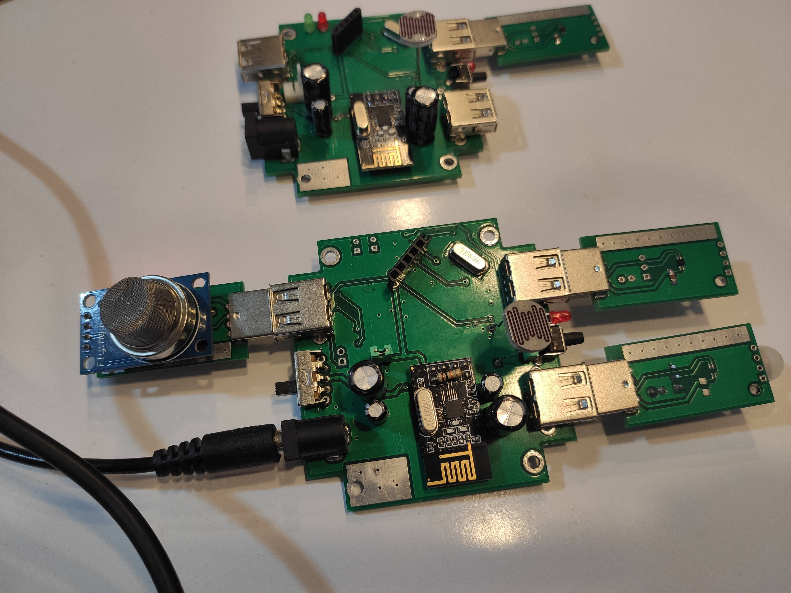
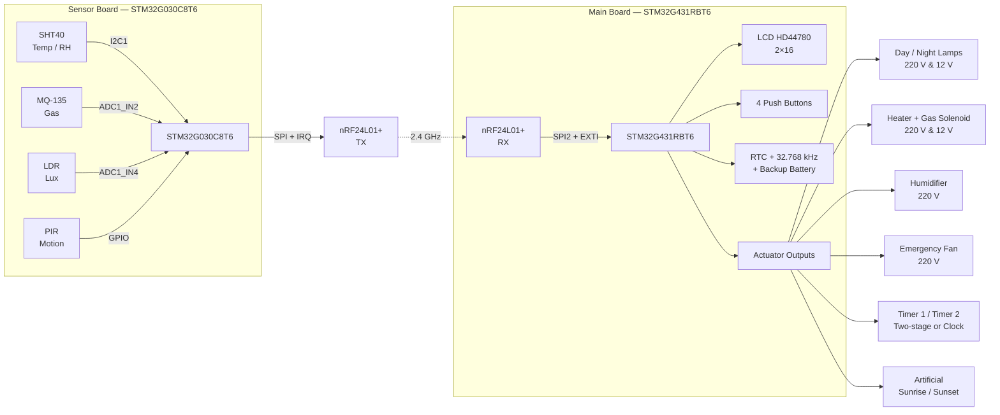
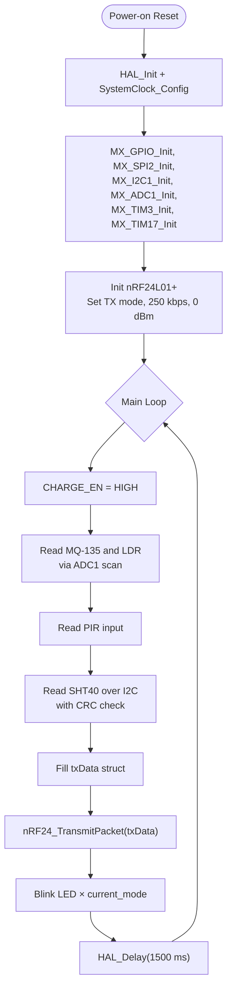

# Z35 Sensor Board — Wireless Environmental Sensor Node

[](https://www.st.com/en/microcontrollers-microprocessors/stm32g030c8.html)
[](LICENSE)
[](https://github.com/m-elec76/Z35_main_board)
[](https://github.com/mzurmand/Z35_main_board)
[](https://github.com/mzurmand/Z35_sensor_board)

The **Sensor Board** of the Z35 platform — a low-power, bare-metal wireless
sensor node that acquires temperature, humidity, gas concentration, ambient
light and motion, then transmits everything to the Main Board over a
2.4 GHz nRF24L01+ link.

Designed for **ornamental bird breeding halls**, **poultry houses**,
**greenhouses** and **mushroom farms**.

---

## 📑 Table of Contents

1. [System Overview](#-system-overview)
2. [Related Repositories](#-related-repositories)
3. [Key Features](#-key-features)
4. [System Architecture](#-system-architecture)
5. [Hardware Pinout](#-hardware-pinout)
6. [Wireless Protocol — nRF24L01+](#-wireless-protocol--nrf24l01)
7. [Firmware Architecture](#-firmware-architecture)
8. [Project Status — What's Done](#-project-status--whats-done)
9. [Roadmap — What's Next](#-roadmap--whats-next)
10. [Build & Flash](#-build--flash)
11. [License](#-license)
12. [Credits](#-credits)

---

## 🔭 System Overview

The Z35 platform is a dual-board system communicating over a 2.4 GHz radio
link:

| Board          | MCU                | Role                                                     |
|----------------|--------------------|----------------------------------------------------------|
| **Sensor**     | STM32G030C8T6      | Acquires SHT40 / MQ-135 / LDR / PIR data and transmits   |
| **Main**       | STM32G431RBT6      | Receives sensor data, drives all outputs, hosts the UI   |

**This repository holds the Sensor Board firmware.** The board is fully
**bare-metal** (no RTOS) and transmits a fixed 10-byte payload once every
1.5 seconds. Its separation from the mains-side actuators improves
measurement accuracy and removes electromagnetic noise from the analog
front-end.

### Target applications

- 🐦 Ornamental bird breeding halls
- 🐔 Poultry houses
- 🌱 Greenhouses
- 🍄 Mushroom cultivation rooms

---

## 🔗 Related Repositories

The Z35 platform is split into four independent repositories:

| Repository | Type | Description |
|------------|------|-------------|
| [**z35-sensor-board**](https://github.com/m-elec76/Z35_sensor_board) *(this repo)* | Firmware | STM32G030C8T6 — acquires SHT40 / MQ-135 / LDR / PIR data and transmits wirelessly |
| [**z35-main-board**](https://github.com/m-elec76/Z35_main_board) | Firmware | STM32G431RBT6 — receives sensor data, drives actuators, hosts the UI |
| [**z35-main-hardware**](https://github.com/mzurmand/Z35_main_board) | Hardware | Main board PCB, schematic, BOM |
| [**z35-sensor-hardware**](https://github.com/mzurmand/Z35_sensor_board) | Hardware | Sensor board PCB, schematic, BOM |

---

## ✨ Key Features

| Feature                          | Details                                              |
|----------------------------------|------------------------------------------------------|
| Temperature + Humidity           | SHT40 over I2C1 with CRC-8 verification              |
| Gas                              | MQ-135 on ADC channel 2                              |
| Ambient light                    | LDR on ADC channel 4                                 |
| Motion detection                 | PIR digital input on PA1                             |
| Wireless link                    | nRF24L01+ @ 2.4 GHz, 250 kbps, 10 selectable profiles|
| Status indicator                 | On-board LED blinks the active RF mode               |
| Mode selector                    | Long-press button on PB6 with EXTI + TIM3 debounce   |
| I2C bus recovery                 | Automatic 9-pulse recovery on stuck bus              |
| Low-power (planned)              | STOP mode between TX cycles                          |

### On-Board Sensors

| Sensor          | Quantity          | Interface       |
|-----------------|-------------------|-----------------|
| SHT40           | Temperature + RH  | I2C1 (PB8/PB9)  |
| MQ-135          | Gas               | ADC (PA2)       |
| LDR             | Ambient light     | ADC (PA4)       |
| PIR             | Motion detector   | GPIO (PA1)      |
| Battery Voltage | Power status      | ADC (PA3)       |  
| nRF24L01+       | TX link           | SPI + IRQ       |
| Status LED      | Mode indicator    | PB7             |
| Mode button     | Profile selector  | PB6 (EXTI)      |

---

## 📸 Gallery

| Main & Sensor (Top) | Main & Sensor (Bottom) |
| :---: | :---: |
|  |  |

| Main Board | Sensor Board |
| :---: | :---: |
|  |  |

### 🎥 Video Demo
[](Docs/videos/z35-demo.mp4)

---

## 🏗 System Architecture



---

## 🔌 Hardware Pinout

### Pin Mapping

| Signal                   | Port / Pin         | Description                          |
|--------------------------|--------------------|--------------------------------------|
| **I2C1_SCL**             | PB8                | SHT40 SCL                            |
| **I2C1_SDA**             | PB9                | SHT40 SDA                            |
| **LED_BLINK**            | PB7                | Status LED (blinks current RF mode)  |
| **BUTTON_INTERNAL**      | PB6                | Long-press RF mode selector (EXTI)   |
| **BURGLAR_ALARM (PIR)**  | PA1                | Motion detector input                |
| **CHARGE_EN**            | PC7                | Battery charge enable                |
| **NRF_CSN**              | PB12               | nRF24L01+ chip-select                |
| **SPI_SCK**              | PB13               | SPI clock                            |
| **SPI_MISO**             | PB14               | SPI master-in / slave-out            |
| **SPI_MOSI**             | PB15               | SPI master-out / slave-in            |
| **NRF_IRQ**              | PA8                | nRF24L01+ IRQ (RX_DR / TX_DS)        |
| **NRF_CE**               | PB11               | nRF24L01+ chip-enable                |
| **ADC_IN2 (MQ-135)**     | PA2                | Analog input — gas sensor            |
| **ADC_IN4 (LDR)**        | PA4                | Analog input — light sensor          |
| **ADC_IN3 (Battery)**    | PA3                | Analog input — battery voltage       | 

### Mode Button

```c
#define BUTTON_MODE_PORT    GPIOB
#define BUTTON_MODE_PIN     GPIO_PIN_6    /* Long press (≥3 ticks) → next mode */
```

### Peripherals

| Peripheral       | Interface            | Notes                                  |
|------------------|----------------------|----------------------------------------|
| nRF24L01+        | SPI + EXTI (PA8)     | TX_DS / RX_DR IRQ on PA8               |
| SHT40            | I2C1 (PB8/PB9)       | Robust driver with bus recovery        |
| MQ-135           | ADC1_IN2 (PA2)       | Raw 12-bit value sent over the air     |
| LDR              | ADC1_IN4 (PA4)       | Raw 12-bit value sent over the air     |
| Battery          | ADC1_IN3 (PA3)       | Raw 12-bit value via voltage divider   |
| PIR              | GPIO input (PA1)     | Debounced in software                  |
| TIM3             | Internal             | 1 ms tick for button hold timing       |
| TIM17            | Internal             | `delay_ms()` time base                 |
| Main clock       | HSE 32 MHz crystal   |                                        |

---

## 📡 Wireless Protocol — nRF24L01+

The link uses **250 kbps**, **2-byte CRC**, **5-byte addresses** and
**auto-retransmit** (1000 µs, 5 retries). Ten profiles are available; the
sensor board and main board **must be set to the same mode** for any
communication to succeed.

### Mode Table

| Mode | Pipe Address (Hex)  | RF Channel | `system_id` |
|:----:|---------------------|:----------:|:-----------:|
| 1    | `A1 B2 C3 D4 E5`    | 76         | `0x6F`      |
| 2    | `67 89 AB CD EF`    | 93         | `0x10`      |
| 3    | `12 34 56 78 9A`    | 27         | `0xBC`      |
| 4    | `0F 1E 2D 3C 4B`    | 35         | `0x59`      |
| 5    | `5A 6B 7C 8D 9E`    | 36         | `0x0C`      |
| 6    | `11 22 33 44 55`    | 40         | `0xDE`      |
| 7    | `AA BB CC DD EE`    | 67         | `0x13`      |
| 8    | `01 23 45 67 89`    | 26         | `0xFA`      |
| 9    | `F0 E1 D2 C3 B4`    | 65         | `0x08`      |
| 10   | `9E 8D 7C 6B 5A`    | 2          | `0x37`      |

### Mode Selection

The active profile is selected by **long-pressing the mode button (PB6)**:

- A rising edge on PB6 starts TIM3.
- If the button is still held after **3 timer ticks**, the profile advances
  (1 → 2 → … → 10 → 1) and TIM3 stops.
- The status LED on PB7 then blinks **`current_mode`** times to show the
  active profile to the user.

### Wireless Payload (10 bytes, packed)

```c
typedef struct __attribute__((packed)) {
    uint8_t  system_id;       /* Network ID — must match on both ends */
    uint8_t  sensor_num;      /* Sensor node number (for multi-node)  */
    uint16_t Temperature;     /* Temperature × 10   [°C]              */
    uint16_t humidity;        /* Relative humidity × 10   [%]         */
    uint16_t gas;             /* Raw ADC value from MQ-135            */
    uint8_t  burglar_alarm;   /* PIR flag: 0 = idle, 1 = alarm        */
    uint16_t ldr;             /* Raw ADC value from LDR               */
} SensorData_t;
```

The `system_id` field is filled by `apply_mode()` on every profile change;
the Main Board drops any packet whose `system_id` does not match its own.

---

## 🧵 Firmware Architecture

The firmware is **bare-metal** — there is no RTOS. The main loop runs at a
fixed cadence:



### Module Layout

| File                  | Responsibility                                          |
|-----------------------|---------------------------------------------------------|
| `main.c`              | Startup, peripheral init, main loop                     |
| `app_config.h`        | Pin map, timing constants, sensor calibration           |
| `app_types.h`         | `SensorData_t` and enum definitions                     |
| `app_globals.c/.h`    | Shared runtime state                                    |
| `app_delay.c/.h`      | `delay_ms()` based on TIM17                             |
| `app_i2c.c/.h`        | I2C bus recovery + SHT40 driver                         |
| `app_nrf.c/.h`        | nRF24 profile table + `apply_mode()`                    |
| `app_button.c/.h`     | Long-press button FSM (EXTI + TIM3)                     |
| `app_sensors.c/.h`    | ADC sampling, PIR read, status-LED blink                |

### I2C Bus Recovery

The SHT40 shares the I2C bus with no other device, but a stuck slave can
still hold SDA low. The driver includes:

1. **Detection** — both SDA and SCL are sampled as inputs; if either is
   held low, the bus is considered stuck.
2. **Recovery** — nine SCL pulses are issued to clock the slave out, followed
   by a manual STOP condition.
3. **Retry** — the transfer is retried once after a successful recovery.

This makes the sensor node resilient against hot-plug, ESD and brown-out
events that would otherwise lock the bus.

---

## ✅ Project Status — What's Done

| # | Feature                                                        | Status |
|:-:|----------------------------------------------------------------|:------:|
| 1 | SHT40 temperature / humidity over I2C with CRC                 | ✅     |
| 2 | I2C bus-stuck detection + 9-pulse recovery                     | ✅     |
| 3 | MQ-135 gas + LDR analog acquisition via ADC scan               | ✅     |
| 4 | PIR motion detection with alarm flag                           | ✅     |
| 5 | nRF24L01+ TX with auto-retransmit                              | ✅     |
| 6 | 10-mode selector via long-press button (PB6) + status LED      | ✅     |
| 7 | Robust I2C transmit / receive with automatic retry             | ✅     |

---

## 🗺 Roadmap — What's Next

| # | Feature                                  | Notes                                                                          |
|:-:|------------------------------------------|--------------------------------------------------------------------------------|
| 1 | **Multi-node support**                   | Assign unique IDs to sensor nodes to allow simultaneous data transmission without collision. |
| 2 | **Battery charge management**            | Implement voltage measurement via ADC (PA3) and control the charge enable pin (PC7). |
| 3 | **Battery level telemetry**              | Send battery voltage via nRF24L01+ and display it on the Main Board LCD        |
| 4 | **Persistent settings storage**          | Save the selected nRF mode and sensor node number (sensor_num)            |

---

## 🤝 Contributing & Collaboration

We believe in the power of open-source and continuous improvement. This project is an ongoing journey. Whether you are an experienced embedded engineer or a passionate hobbyist, **you are highly welcome to contribute.**

### 🛠️ How you can help:
- **Firmware Development:** Help implement the features in the Roadmap (e.g., Multi-node support, or Battery charge management).
- **Hardware Design:** Contribute to PCB and Schematic revisions.
- **Bug Reports & Suggestions:** Found a bug or have an idea? Feel free to open an **Issue**.
- **Code Review:** If you spot an inefficiency, feel free to open a **Pull Request**.

*Let's build a robust, reliable, and fully open environmental controller together!*

> 📖 **For detailed guidelines on coding standards, architecture rules, and how to submit a Pull Request, please read our [CONTRIBUTING.md](CONTRIBUTING.md).**

---

## 🛠 Build & Flash

### Requirements

- STM32CubeIDE 1.18 or newer
- ST-Link V3 programmer
- Firmware package: `STM32Cube FW_G0 V1.6.0`

### Build Steps

```bash
cd Sensor_Board/
make -j4 all
# then flash SensorBoard.elf via ST-Link
```

---

## 📜 License

Copyright 2026 Mohammadali Abbasi

Licensed under the Apache License, Version 2.0 (the "License");
you may not use this file except in compliance with the License.
You may obtain a copy of the License at

    http://www.apache.org/licenses/LICENSE-2.0

Unless required by applicable law or agreed to in writing, software
distributed under the License is distributed on an "AS IS" BASIS,
WITHOUT WARRANTIES OR CONDITIONS OF ANY KIND, either express or implied.
See the License for the specific language governing permissions and
limitations under the License.

---

## 🙏 Credits

- **Firmware Author:** Mohammadali Abbasi <m.elec76a@gmail.com> 
  — Designed and implemented the complete firmware (Bare-metal architecture, I2C driver with recovery, ADC sampling, long-press state machine, and wireless TX integration).
- **Hardware Designer:** Mohammadreza Zourmand <mzselec@gmail.com> 
  — Custom 2-layer PCB for the sensor node.
- **HAL Driver:** STMicroelectronics
- **nRF24 Driver:** Ilia Motornyi — [nrf24l01-lib](https://github.com/elmot/nrf24l01-lib) (licensed under The Unlicense)

Special thanks to the open-source community for making this project possible.

---

> **Z35 Sensor Board** — the eyes and ears of the environmental controller.